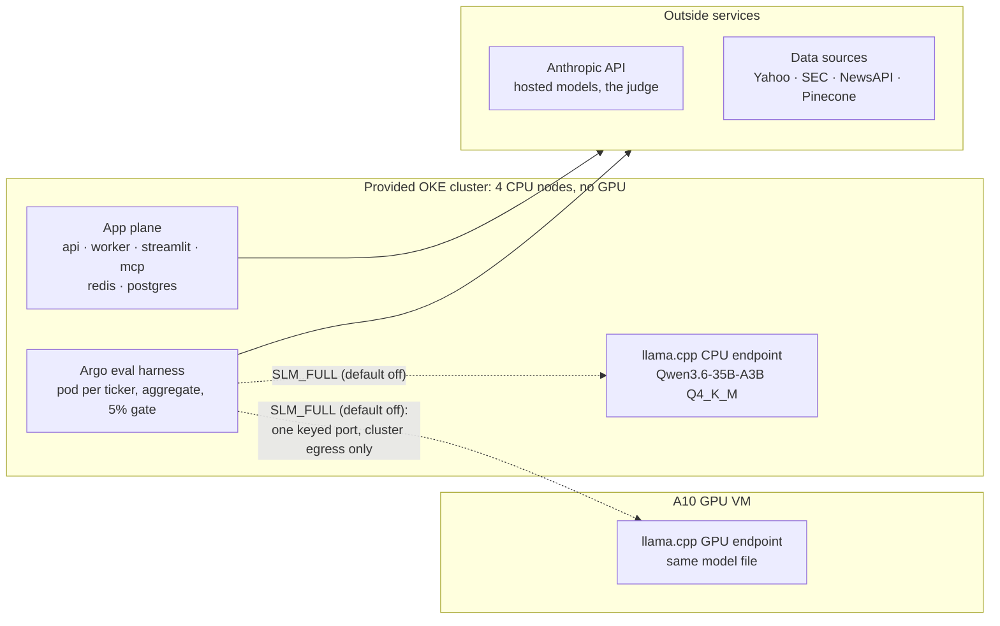

# Enablement and Evaluation of a Financial Research Agent on Oracle Cloud Infrastructure

Samuel Chen · Report date 2026-10-19 · Figures are the numbers of record of
2026-10-07 unless marked as dated; every figure is in
[numbers-of-record.md](numbers-of-record.md) with its run ID, interval and
the command that produced it.

Most agent projects stop once a pipeline produces plausible output. The
harder question is whether a self-served open-weight model on OCI can
replace a hosted model for a real workload, and how that can be shown with
measurements rather than impressions. The Financial Research Agent was
rebuilt on Oracle Cloud Infrastructure to answer it.

## Recommendation

**Hosted Claude stays the production path. A self-served open-weight model
on OCI is now a measured alternative:** it gets stock figures wrong about as
rarely as hosted, states fewer of them, and costs less per brief on CPU at
13.7 times the latency. CPU serving suits batch work; the A10 suits
interactive latency. Neither self-served route is in production
(`SLM_FULL=false`).

The Financial Research Agent writes a brief on any public company from SEC
filings, market data and news. Everything below was measured on OCI in
October 2026, 40 tickers per run, on images pinned by git SHA, and comes
from a committed, re-runnable harness.

- **Accuracy, no judge involved.** Wrong stock figures, adjudicated: 1 of
  565 checked numbers hosted vs 1 of 432 for Qwen3.6-35B-A3B on an A10. Not
  separated. Hosted states more figures: 4.47 vs 3.05 bound to stock data
  per brief (CI on the difference +0.93 to +1.93).
- **Accuracy, LLM judge.** Judge-flagged unsupported claims, judge v2, mean
  of three judgings: hosted 2.55%, A10 3.57%. No difference detected, and the
  judge itself is weak: about 29% precision and 11% recall against blind
  labels from a single human labeler.
- **Cost per brief, model only.** Hosted $0.0357; A10 at most $0.0303; CPU
  on OKE $0.0107 (previous image), at 13.7 times hosted's time per ticker.
- **CPU sizing.** On an E5 node, prompt processing speeds up 1.8× from 4 to
  8 vCPU and then stops; generation holds at about 13 tok/s.
- **Turned off, each for a measured reason:** a QLoRA fine-tune,
  cross-encoder reranking, and a multi-agent critic.

## Mapping the system to harness engineering on OCI

Sanjay Basu's post
[Harness Engineering using OCI CPU & OKE](https://blogs.oracle.com/cloud-infrastructure/harness-engineering-using-oci-cpu-oke)
argues that a harness spends most of its time waiting on inference served
somewhere else, so it belongs on CPU nodes in OKE, with inference sized
separately and no GPU idling behind it. This system is one concrete
instance of that layout, with measurements attached.

| The post's term | This system |
|---|---|
| Harness: one agent loop with tools | The `/ask` agent: a LangGraph ReAct loop over four tools (stock data, news, SEC filings, filing retrieval) |
| Hand-wired DAG, fixed and auditable | The brief pipeline, and the Argo eval workflow: one pod per ticker, then an aggregate step and the gate |
| Goal-plus-judge loop | Multi-agent supervisor: draft, judge, revise at most twice. Ships default-off: no grounding gain at higher cost and latency |
| Meter: self-checks on finished traces, as a batch job | The Argo eval run judging finished briefs; the per-request traffic proof; the numeric check rerun over a run's briefs |
| KEDA scaling on queue depth | Celery worker scaled 1 to 4 replicas on Redis queue depth (verified with a no-model test backlog only) |
| Restricted egress | Inbound side only so far: the A10 endpoint needs a key and admits only the cluster's egress IP. Harness egress is not yet restricted |

The full mapping, with what is built and not built:
[harness-mapping.md](harness-mapping.md).

One difference: the post's harness calls inference off-box, while this
system also serves a model in-cluster on CPU. The measurements here
indicate in-cluster CPU inference suits batch work, which is consistent
with sizing inference separately from the harness but does not prove it.
Behind this harness, the A10 averaged 36% busy over a 40-ticker run,
consistent with the post's point that GPU capacity sits idle behind
orchestration.

## Running it on OCI

The app plane, the eval harness and a CPU model endpoint run on an OKE
cluster of four VM.Standard.E5.Flex nodes; a VM.GPU.A10.1 serves the same
model file on GPU.

A brief starts with yfinance market data, NewsAPI news and EDGAR filing
summaries. The SEC sections are grounded in filing text through Pinecone
RAG. Claude Haiku writes four middle sections in parallel, Claude Sonnet
writes the Executive Summary and Outlook, and a LangGraph ReAct agent
answers follow-up questions with the same tools.

The self-served arms are off by default (`SLM_FULL=false`). One kustomize
base carries kind, k3s, OKE and provided-OKE overlays, and
`scripts/render_diff.py` proves an overlay change never alters the kind
render. The provided cluster is codified with `terraform import` to a
zero-diff plan. The test suite is 676 tests. How to deploy it:
[deploy-oci.md](deploy-oci.md). Full topology:
[architecture.md](architecture.md#deployed-topology-october-2026).

## Why the evaluation has two layers

The deterministic numeric check now leads and the LLM judge is secondary,
because each catches what the other misses and the judge turned out to be
the weaker instrument.

**Numeric check.** Every figure a brief states is bound, where possible, to
the stock-data field it came from, and a mismatch is flagged. Flags are
adjudicated by hand under rules committed before the verdicts. It caught
Toyota's revenue: a figure in the filer's reporting currency, labeled USD,
which the judge accepted. After a stock-data fix and a currency-labeling
prompt rule, currency-label errors went from 22 (hosted) and 11 (A10) to 0
and 0. Its blind spot is a correct figure under the wrong label; the judge
flags those.

**LLM judge.** A Claude judge (prompt v2, versioned) splits the synthesis
into claims and labels each SUPPORTED, INFERENCE or UNSUPPORTED against the
retrieved context. Re-judging identical inputs showed it moves by up to 2×
between judgings, so every rate of record is now the mean of three
judgings with its range.

The judge is calibrated against blind labels from a single human labeler:

| Calibration | Judge v1 (2026-09-04, dated) | Judge v2 (2026-10-07, of record) |
|---|---|---|
| Sample | 50 claims, not blind | 180 claims labeled blind by one labeler, strata reweighted |
| Precision on UNSUPPORTED | 1/3 | 29.4% (CI 8.3 to 52.9%) |
| Recall on UNSUPPORTED | 1/9 | 11.4% (CI 3.1 to 27.9%), population-weighted |

V2's precision is dragged down by hedged Outlook watch-items: 14 of 16
judge-flagged claims carried a human INFERENCE label. Corrected for recall,
the estimated true unsupported rates are wide: 3.8% (CI 1.9 to 9.7%) hosted
and 8.7% (CI 5.4 to 18.5%) on the A10, with no test between them. That is
why "not detected" is the strongest grounding claim this evaluation
supports.

## Hosted vs self-served Qwen3.6-35B-A3B

On the current image the A10 arm matches hosted on wrong figures, trails it
on how many figures it states, and shows no judge-detected grounding
difference.

**Why this model.** Between MiniMax and Qwen, Qwen3.6-35B-A3B was chosen:
about 3B active parameters per token gives MiniMax's efficient-MoE profile
at a size that fits here. Every open MiniMax model is 230B total or larger,
too big for one A10 or one E5 node. One ~20 GB Q4_K_M GGUF fits both, so
the same file compares CPU against GPU serving.

**Why llama.cpp, not vLLM.** Computed from the published artifacts, not
booted: no 4-bit build leaves usable KV-cache room on one A10 for about 8
concurrent requests of up to 5k tokens, and no vLLM image with this
architecture's quantized-layer fix supports the A10 VM's CUDA 12.8 driver.
llama.cpp's CUDA build serves the GGUF with all layers on the GPU.

| Image `f3043751`, 40 tickers | Hosted (`4hsn2`) | Qwen3.6 on A10 (`nstp9`) |
|---|---|---|
| Wrong stock figures, adjudicated | 1/565 | 1/432 |
| Figures bound to stock data per brief | 4.47 | 3.05 |
| Judge-flagged unsupported, judge v2, mean of 3 judgings (range) | 2.55% (1.47 to 3.76%) | 3.57% (3.27 to 3.75%) |
| Model cost per brief | $0.0357 | at most $0.0303 |
| Pipeline time per ticker | 26.7 s | 34.6 s |

The paired ticker-level CI on the judge-flagged difference is -4.39 to
+1.78 points. The A10 cost is a ceiling: the whole VM at $2.00 an hour over
the run, with the GPU averaging 36% busy. At parallelism 4 the same arm ran
100.8 briefs an hour against 66.0, a ceiling of $0.0198 per brief, with no
measurable change in what it wrote.

**The CPU arm**, on the previous image (`8vpq6`): judge-flagged 2.89% across
three judgings, $0.0107 per brief for the llama.cpp pod's request, and 355 s
per ticker. That is batch work, not interactive.

**Traffic proof.** A self-served run counts only if the server's own
per-request log matches the harness's calls one for one, so no hosted
fallback can leak into an SLM arm. Two CPU runs on the current image failed
the counter-based proof in force when they ran, so no figure from either is
cited.

## Sizing the CPU harness

The OKE CPU endpoint is sized right at 8 vCPU: prompt processing gains 1.8×
from 4 to 8 vCPU and nothing after, and generation stays near 13 tok/s at
every level.

These figures measure model inference on CPU, not harness orchestration;
the harness itself is the subject of a pre-registered benchmark not yet
run ([harness-benchmark-plan.md](harness-benchmark-plan.md)). All figures
below are llama-bench on the same Q4_K_M GGUF, single request, 2,048-token
prompt and 128-token generation, no judge (dated 2026-10-08 and
2026-10-16).

| OCI shape | Threads / vCPU | Prompt tok/s | Generation tok/s |
|---|---|---|---|
| E5.Flex (AMD EPYC 9J14), OKE node | 4 / 8 / 15 | 61.1 / 109.8 / 103.6 | 12.9 / 13.3 / 12.8 |
| VM.GPU.A10.1 host CPU (Intel Xeon 8358) | 4 / 8 / 15 / 28 | 43.8 / 80.4 / 122.5 / 116.3 | 10.8 / 15.9 / 20.8 / 22.1 |
| VM.GPU.A10.1, all layers on the A10 | n/a | 2,299.5 | 110.4 |

The A10 runs about 5× the best CPU on generation and about 19× on prompt
processing. This compares OCI shapes, not chips: core layout, memory, OKE
node vs k3s VM and neighboring pods all differ, and memory bandwidth was
not measured. More CPU throughput would come from more replicas on
separate nodes, which is an inference, not a measurement. The instruction
set also decides whether an engine runs at all: vLLM's prebuilt CPU image
requires AVX-512 and crashes on AVX2-only hosts, which bears on the post's
X12 condition. Details: [gpu-inference.md](gpu-inference.md).

**Scaling the workers.** KEDA now scales the Celery worker on Redis queue
depth, 1 to 4 replicas on the OKE cluster. A test backlog of 8 tasks that
make no model call scaled it to 4 and back to 1. Scaling under real request
load has not been measured.

## What was turned off, and why

Three techniques are in the code and ship disabled, and the small-model
experiments before Qwen3.6 explain why a fine-tune did not make the cut.
These are dated September and October records, each on its own image.

| Experiment | What was measured | Decision |
|---|---|---|
| QLoRA fine-tune of Qwen2.5-1.5B writing Financial Health and Risk Factors, vLLM on an A10 (2026-09-05/06) | 8.15% vs 3.06% judge-flagged unsupported (judge v2), fails the 5% gate. Claim-level Fisher p = 0.0023; ticker-level paired CI +2.08 to +10.95 points, sign test p = 0.078. Attributed to its own sections: 19.82% vs 0.50% | `USE_LOCAL_MODEL` off |
| Cross-encoder reranking, pre-registered (2026-10-08) | Refused filing answers 5 vs 7 of 35, no drop; +11.0 s per ticker, 41.5% against a 20% limit | Off |
| Multi-agent critic (June, judge v1) | No grounding headroom to show; its cost and latency came from an uncommitted harness, so they are not quoted | Off, harness kept |

**Four-arm comparison (2026-09-23).** To separate fine-tuning from model
size, the same 40 tickers were run with four writers for the two local
sections, all on vLLM on the A10 (node vm-a10-inst-2, vLLM v0.10.2, judge
v2).

| Writer of Financial Health + Risk Factors | Judge-flagged unsupported | Wrong stock figures | Output tok/s on A10 |
|---|---|---|---|
| Hosted (two runs) | 1.04%, 1.80% | 1.1% (pooled) | n/a |
| Qwen2.5-7B-Instruct | 4.58% | 3.9% | 194.6 |
| Fine-tuned Qwen2.5-1.5B | 6.49% | 15.7% | 711.5 |
| Qwen2.5-1.5B-Instruct, untuned | 7.75% | 14.9% | 711.3 |

The fine-tune did not separate from its own base (p = 0.58), and every
local arm trailed hosted. Fine-tuning showed no detected gain over its
base, and the 7B was the closest local arm (1.5B vs 7B, p = 0.076). It is
not a size curve, since hosted is a different model family. The September
recommendation for that comparison is kept as a dated record:
[model-recommendation.md](model-recommendation.md).

**Quantization (2026-09-29).** A GPTQ W4A16 build of the fine-tune served
at 1,075.7 vs 708.3 output tok/s at concurrency 8, with no detected
grounding difference (6.69% vs 6.49%, p = 1.00). A pre-registered numeric
replication on identical inputs did not reproduce an apparent W4A16
regression either, though its interval allows up to +11.6 points.

## What human labeling caught

The most consequential defect in the project was found by reading claims
by hand; neither the judge nor any test could have caught it.

During labeling, the same pattern kept appearing: "risk factors" drawn from
RSU agreements and indentures. EDGAR's filing index links inline-XBRL
primary documents through an `/ix?doc=` viewer URL. The href pattern missed
it, the exhibit filter rejected the remaining files, and the fallback took
the first HTML file, usually an exhibit. For AAPL that was the bylaws.
Before the fix, risk retrieval passed verification for 3 of 40 tickers.

The judge checks claims against the context it is given, so a brief built
on the wrong document can still score as grounded.

The fix (2026-09-04) was three layers: a shared primary-document resolver
that unwraps `/ix?doc=`, HTML entity decoding so headings like
`Item 1A.&#160;Risk Factors` anchor, and an exclusion for cross-references
such as "Item 1A of this Form 10-K". After reindexing, 32 of 40 passed.
Every grounding number measured before that date is kept only as a dated
record of the old pipeline.

## What has not been verified

The largest limits are thin context on some tickers and a judge too weak to
separate arms whose difference is small.

- Of the 40 tickers, the 5 ADRs (20-F filers) get no SEC context, RDFN and
  VERV get no stock figures, and 32 had no news in the hosted run of
  record.
- Judge recall is about 11% with a wide interval, so judge-flagged rates
  are lower bounds and "no difference detected" is not "no difference".
- The harness itself has not been benchmarked: every CPU figure above is
  model inference. The plan is pre-registered in
  [harness-benchmark-plan.md](harness-benchmark-plan.md).
- Only one closed-source model family (Claude) has been compared.
- vLLM serving on OKE has not run. The OKE Terraform for a cluster with an
  A10 pool is validated but never applied; the provided cluster is
  imported, not created.
- Moving synthesis from Sonnet to Haiku is held back pending a quality
  re-eval; the $0.0366 cost of record is measured with Sonnet.

## Next steps

- Run the harness benchmark: harness throughput and CPU use on E5 with the
  model removed as the bottleneck.
- Pipeline fixes from the recorded limitations, each followed by new
  baselines on every arm.
- Fold the per-request traffic proof into the eval target instead of a
  separate manual step.
- Harness on OCI CPU: API keys from OCI Vault, separate node pools (E6
  control plane, A2 workers with multi-arch images), and a NetworkPolicy
  limiting pod egress to the model endpoints and data sources.
- App plane: late acknowledgement with an idempotent research task,
  persisted async briefs, and a timeout on the Anthropic client.

## Sources

- Every figure, with its run ID, interval and command:
  [numbers-of-record.md](numbers-of-record.md).
- How to deploy it: [deploy-oci.md](deploy-oci.md). Architecture:
  [architecture.md](architecture.md). Evaluation method and dated runs:
  [eval-methodology.md](eval-methodology.md).
- [Harness Engineering using OCI CPU & OKE](https://blogs.oracle.com/cloud-infrastructure/harness-engineering-using-oci-cpu-oke),
  OCI blog, 2026-09-28.

Thanks to the OCI team for the A10 and OKE capacity this was built and
measured on.
